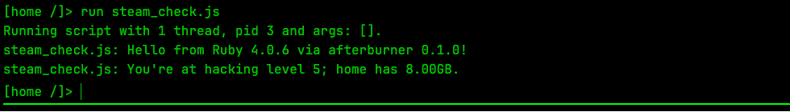

# afterburner

Write [Bitburner](https://github.com/bitburner-official/bitburner-src) scripts in Ruby.
(afte**rb**urner: the rb is right there in the middle.)

```ruby
# src/scout.rb — run it in the game as: run scout.js n00dles
target = ARGV.first || "n00dles"
ns.nuke(target) unless ns.root_access?(target)

server = ns.server(target)
puts "#{target}: #{ns.format.number(server.money_max)} max, security #{server.min_difficulty}"
logger.info "scouted #{target}"
```

afterburner is one local process that:

- **serves the game's Remote API**, syncing your files into the game the way
  [bitburner-filesync](https://github.com/bitburner-official/bitburner-filesync) does (it replaces it);
- **runs your `.rb` scripts in real Ruby** (MRI: gems, `debug`, your own editor);
- **gives the game a small JavaScript stub for each one**, which claims the script's RAM and makes its `ns` calls.

From the game's side, `scout.rb` is just `scout.js`: `run`, `kill`, `ps`, threads, and RAM all work as
usual, and the game charges a Ruby script for the functions it calls, exactly as it would JavaScript.



## Quick start

You need Ruby 3.4 or newer and Bitburner v3.

```ruby
# Gemfile
gem "afterburner", github: "mediocretes/afterburner"
```

```sh
bundle install
mkdir src && echo 'puts "Hello from Ruby #{RUBY_VERSION}!"' > src/hello.rb
bundle exec afterburner watch
```

Then, in the game:

1. **Options → Remote API**: port `12525`, then **Connect**. In Chrome, allow the site's local network access when
   asked. (Chrome requires that for any tool on your machine, bitburner-filesync included.)
2. While you're there, set **Reconnection delay** to a few seconds, so the game reconnects by itself whenever you
   restart afterburner.
3. `run hello.js`

### With the TypeScript template

If you use the official [typescript-template](https://github.com/bitburner-official/typescript-template),
afterburner reads its `filesync.json` and takes over from bitburner-filesync. In `package.json`, swap
`bitburner-filesync` for `bundle exec afterburner watch`. `tsc` keeps compiling `src/*.ts` into `dist/`;
afterburner syncs `dist/` and runs `src/*.rb`.

### Starting it with a double-click

[`launchers/`](launchers) has two files to copy into your project, next to your Gemfile:
`start_afterburner` for macOS and `start_afterburner.cmd` for Windows. Double-click one and it opens
a window running everything the project needs:
- it installs anything missing (`bundle install`, and `npm install` for the TypeScript template);
- then it runs `npm run watch` if your `package.json` has a watch script, or `afterburner watch` if not.

Close the window, or press Ctrl-C, to stop. afterburner runs only while that window is open, and nothing is
installed to start it for you. The folder whose files become the game's home folder is set at the top of each
launcher (`SCRIPTS=src`). From a terminal, it's `--src DIR` or the `AFTERBURNER_SRC` environment variable.

## Writing Ruby scripts

Each file under `src/` is a script (`src/tools/scan.rb` runs as `tools/scan.js`), except files under a `lib/`
folder, which are libraries for scripts to `require_relative`. Put helpers, and patches to Ruby's own classes
(`class Float; def to_pct …`), in `src/lib/`; a script can also reopen a class directly, and it reopens the
real one.

**`ns`** has every Netscript function, under Ruby names:

```ruby
ns.hack("n00dles")                        # ns.hack
ns.server_max_money("n00dles")            # ns.getServerMaxMoney: snake_case, get_ dropped
ns.root_access?("n00dles")                # ns.hasRootAccess: questions get a ?
ns.hacknet.num_nodes                      # namespaces
ns.hack("n00dles", additional_msec: 50)   # options as keyword arguments
ns.getServerMaxMoney("n00dles")           # the JavaScript names work too
```

Functions that act and report whether it worked (`nuke`, `scp`, `kill`) keep plain names. A typo raises
`NoMethodError` with suggestions.

**`AB`** holds afterburner's own tools, kept out of `ns` so that `ns` has only the game's functions. It works
in scripts and in the console, where it's most useful:

```ruby
AB.functions(/server/)   # matching functions: Ruby name, RAM, JavaScript name
AB.doc(:hack)            # the Ruby call, its keyword options, the signature, and the game's docs
AB.doc("cloud")          # a namespace's functions
ns.methods               # every Ruby name ns answers to; in the console, ns.<Tab> completes them
```

**Game objects** come back as records with snake_case readers:

```ruby
server = ns.server("n00dles")
server.money_max          # moneyMax
server.admin_rights?      # hasAdminRights
server[:money_max]        # same thing
server.keys               # [:hostname, :ip, ..., :money_max, ...]; in the console, server.<Tab> completes them
server.to_h               # { hostname: "n00dles", money_max: 1750000, ... }

case server
in { has_admin_rights: false } then ns.nuke(server.hostname)
in { money_max: 0 } then logger.info "nothing to take"
end
```

**`ns` and `logger` work anywhere in your code** while the script runs: in libraries, in your own classes, in
methods you add to Ruby's:

```ruby
# src/lib/formatting.rb
class Numeric
  def to_pct = ns.format.percent(self)
end
```

Each running script gets its own `ns`, even when several share a library.

**Output:** `puts`, `print`, `p`, and `warn` go to the game's terminal, from anywhere in your code. `logger`
writes to the script's log window (`ns.ui.open_tail` shows it).

**Also there:** `ARGV` (the script's arguments), `exit`, `abort("why")`, `at_exit { }`, and Ruby's own
`sleep` alongside `ns.sleep(ms)`. Errors from the game raise `NetscriptError`, which you can rescue; an
uncaught Ruby exception shows up in the game's error dialog with its backtrace. Scripts can `require` any gem
in your Gemfile.

## Hot reload

Save a script while it's running and afterburner restarts it in place: same pid, same arguments, new code,
with `afterburner: reloaded` in its log. The old code's `at_exit` blocks run first. Saving a library under
`lib/` reloads it and restarts the scripts that use it; even with nothing running, the next script to start
gets the new code.

The game won't let a running script use more RAM than it started with, and it counts every function the
process has called, old code included. So if the new code would need more than the stub claimed, afterburner
leaves the old code running and says so; run the script again to pick up the change. A reload also waits for
any `ns` call in progress (a `hack`, say) to finish. `--no-reload` turns it off.

## When afterburner restarts

Restarting afterburner, or stopping it for a while, doesn't stop your Ruby scripts. Each one waits, however long
that takes, and starts again from the top when afterburner is back: same pid, threads, arguments, and RAM. Its log
says so, and afterburner's log counts how many came back in one line. As with a reload, Ruby state from before is
gone; unlike a reload, the old run's `at_exit` blocks don't run, because the process they lived in has stopped.
If the code now needs more RAM than the process claimed, the script ends quietly and its log says to run it again.

Scripts on other servers resume too. When the game connects, afterburner brings every copy of
`afterburner/proxy.js` your scripts have put on other servers (with `ns.scp`) up to date with its own. The console
ends when afterburner stops; start it again.

## Commands

| | |
|---|---|
| `afterburner watch` | Serve the game: sync files, run Ruby scripts. Leave it running. |
| `afterburner console [--ram AMOUNT]` | IRB with `ns` live in the game. It pushes `afterburner/console.js`; run that in the game and type away. It claims 80% of the RAM free on the server you run it on, or what `--ram` says: GB (`--ram 8`) or another share (`--ram 50%`). The game charges each new function you call against the claim. `ns.<Tab>` completes, and `AB.doc(:name)` shows a function's docs. |
| `afterburner save [FILE]` | Download the game's live save, as the in-game export would. |
| `afterburner ram FILE...` | RAM a script needs: `.rb` files are scanned locally, with a breakdown; anything else is the game's own figure. |
| `afterburner stub FILE.rb` | Print the JavaScript stub the game runs for a script. |
| `afterburner restore [--dry-run] [--force]` | Copy the Ruby scripts kept in the game's save into `src/` (see below). |

Options: `--port`, `--src` (Ruby scripts; default `src`, or `AFTERBURNER_SRC`), `--dist` (other files to sync; default from
`filesync.json`, or none), `--definitions`, `--costs`, `--no-reload`, `--origin URL` (accept the game from
another address), and `--verbose` (log every message to and from scripts, for bug reports). Run
`afterburner --help` for details.

## Your Ruby code travels with the save

The game keeps JavaScript in your save, but Ruby lives on your disk. So afterburner also keeps a copy of every
`.rb` under `src/` in the save, as `afterburner/src/hello.rb.txt`, updated as you edit. Move the save to
another machine (Steam Cloud, an export) and the code goes with it; there, run:

```sh
bundle exec afterburner restore --dry-run   # what would change
bundle exec afterburner restore
```

It writes what `src/` is missing and what the save has newer, and keeps your file where it's newer (`--force`
takes the save's, after backing yours up in `.afterburner/replaced/`). Going the other way, afterburner never
overwrites a newer copy in the save with an older local file; it says so instead.

Getting code *out* of the save is never automatic, because any script in the game can write files there: a
script you pasted in could plant Ruby that afterburner would then run on your computer. `restore` lists
everything it writes; look over code you didn't write.

## RAM

The game charges every script 1.6 GB plus the cost of each distinct function it uses, and it stops a script
that calls a function it wasn't charged for. So afterburner works out each Ruby script's RAM the way the game
does for JavaScript, by reading the source (with [Prism](https://github.com/ruby/prism)): it counts calls made
through `ns`, `@ns`, or a variable holding a namespace (`hacknet = ns.hacknet`), and follows `require_relative`.
`afterburner ram src/scout.rb` shows the breakdown.

It charges only code the script can reach, so you can keep a rich library of classes and a small worker still pays
for just what it uses. A worker that requires `lib/server.rb` and calls `server.security_ratio` pays for the two
functions behind it, not for every method in the file. Code outside methods (a script's body, a class body) always
counts; a method counts if anything reachable calls it by name, in any class; and lambdas kept in a constant count
if reachable code uses the constant. Matching methods by name over-charges a little, never under-charges.
`afterburner ram` lists what it didn't charge. If reachable code calls methods in a way it can't follow, such as
`obj.public_send(name)` or `map(&name)` with the name in a variable, or `eval` of a string, it charges everything
the script requires, as if all of it ran, and says why. Load other files with `require_relative` and a literal
path: that's what the scan follows.

To call a function chosen by name, use `ns.public_send(:brutessh, host)` (or `send`) with a literal symbol, which
is charged. A call it can't see (a name in a variable or built at runtime, say) isn't charged, and the game stops
the script when it makes that call, with a note explaining why.

The game's documentation is a little off for some functions whose cost depends on your progress. So when a
script starts, afterburner also asks the game what each function actually costs (that's free), caches the
answers in `.afterburner/`, and updates any stub whose number changes.

## Security

Giving the game local network access means any script in it can reach your machine, and afterburner runs Ruby.
So afterburner listens on localhost only; takes connections only from the game's own pages (another website in
the same browser can't drive it); runs only `.rb` files under `src/`, by plain relative name; and never evaluates
code the game sends. The console, `save`, and `ram` refuse browser connections entirely. It's not a sandbox for the
Ruby you write: that's your code, on your machine.

One thing it can't stop: any script in the game can start any of your Ruby scripts, with arguments of its
choosing, because a stub is just a file that anything in the game can write. Only code already in `src/` ever
runs, but if a script touches your machine beyond `ns` (writing files, the network), treat `ARGV` as untrusted.

## Platforms

- **Web build, in Chrome**: tested. Needs the local network permission.
- **Steam build**: tested on macOS and Windows. No permission needed. If afterburner ever logs
  `refused a connection from …`, please open an issue with that origin.
- **Windows**: tested with the Steam build, using Ruby from [RubyInstaller](https://rubyinstaller.org)
  with its DevKit (`winget install RubyInstallerTeam.RubyWithDevKit.4.0`, then `ridk.cmd install 1 3`).
  The unit tests also run there in CI.

## Limits

- A Ruby loop that never waits (no `ns` call, `sleep`, or IO) stalls every Ruby script, the way a JavaScript loop
  without `await` freezes the game; killing it in the game can't interrupt it.
- One game at a time: a second game connecting (another browser tab, say) takes over from the first.
- A game object's field whose name is also a Ruby method (`hash`, `class`, `display`) has to be read as
  `record[:hash]`.
- Reloading the game stops all running Ruby scripts. When a save loads, the game restarts them, and each one
  waits for afterburner to be running.
- Functions that take callbacks or return objects with methods (`ns.get_port_handle`, React-node printers) don't
  cross over, except `ns.at_exit { }`, which runs in Ruby.
- Each running Ruby script holds one WebSocket. That's fine for scripts that make decisions; workers you run at
  hundreds of threads are better left as three-line JavaScript files.

## How it works

See [DESIGN.md](DESIGN.md): the architecture, both protocols, how RAM is worked out, and what's next.

## Development

```sh
bundle install
bundle exec rake test     # unit tests, a few seconds
```

The end-to-end test drives the live web game in a headless browser, with a fresh save in its own profile:

```sh
(cd test/e2e && npm install && npx playwright install chromium)
bundle exec rake e2e
```

## License

MIT. Bitburner is by its own authors and isn't affiliated with this project.
